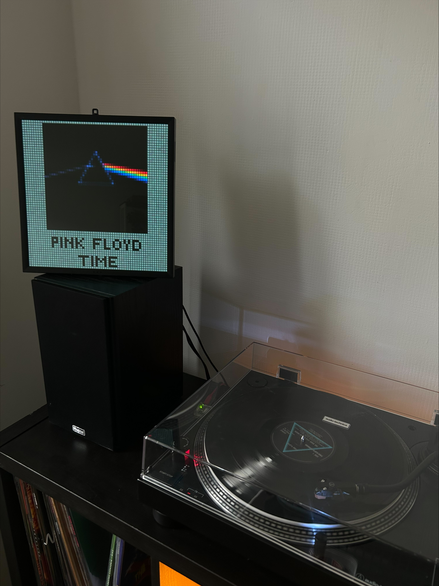
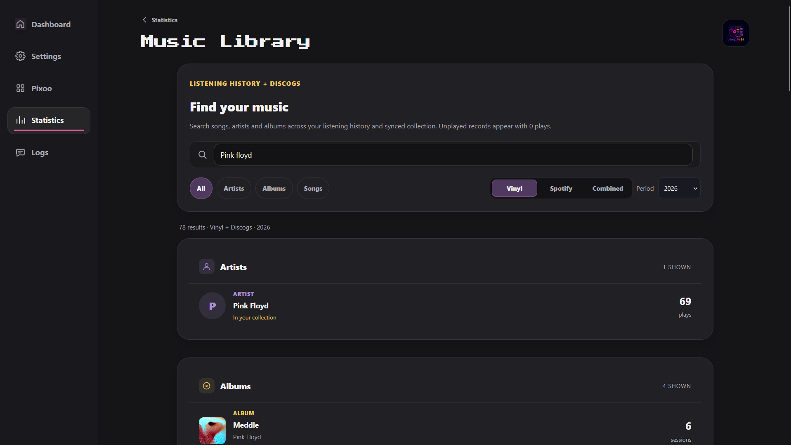
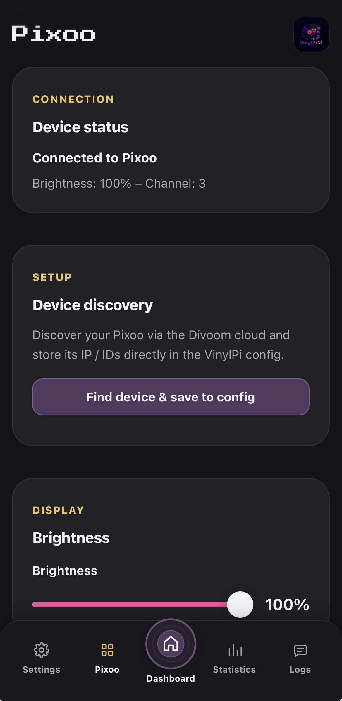
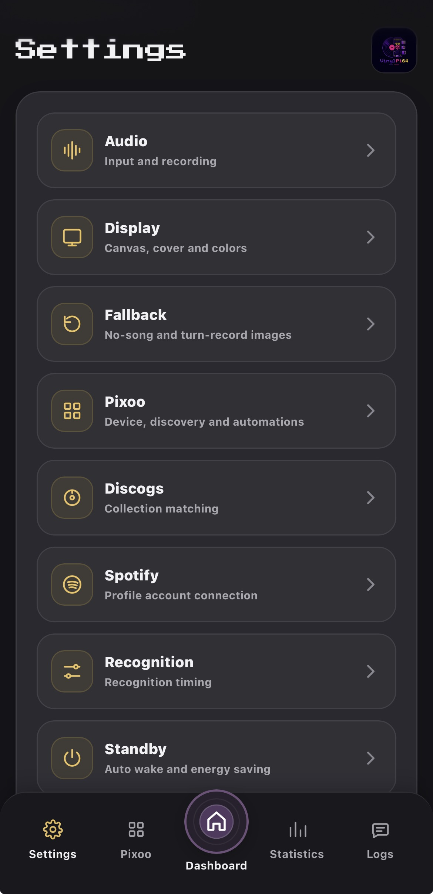
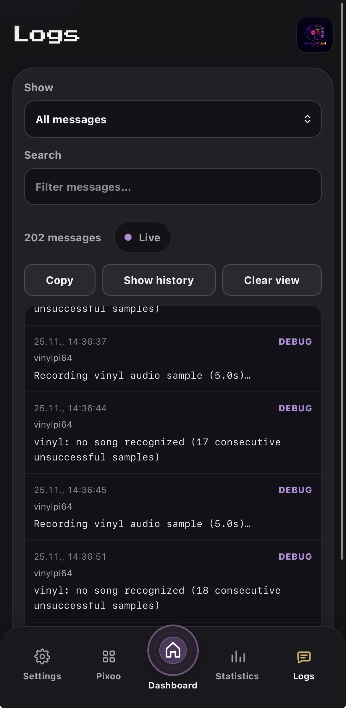

# VinylPi64

<p align="center">
  
  
  
  <a href="https://github.com/simontrost/VinylPi64/stargazers"></a>
</p>

VinylPi64 identifies music from a USB turntable using a native Rust fingerprinting client or from **Spotify**, builds a custom **64×64 pixel frame**, and displays it on a **Divoom Pixoo-64**. A local web app provides controls, settings, lyrics, device management, and listening statistics.

<p align="left">
  
</p>

## Features

- Vinyl recognition from USB audio using native Rust audio fingerprinting and Spotify playback recognition
- Album artwork, artist, title, album, genre, and track metadata
- Low-power audio standby with configurable wake-on-audio and audio-level auto-standby
- Optional failure-based auto-standby for Vinyl and Spotify
- Pickup usage tracking based on configurable input-level thresholds
- Custom Pixoo renderer with:
  - dynamic or manual background and text colors
  - configurable cover size, typography, spacing, and marquee text
  - fallback images
- Local web app with:
  - live dashboard updates and Vinyl / Spotify / Off modes
  - lyrics and track information
  - Pixoo brightness, channels, discovery, reboot, and community GIFs
  - statistics for listening time, pickup usage, songs, artists, albums, genres, and covers
- SQLite storage for songs, statistics, caches, and runtime state
- Configurable adaptive sample duration after failed recognitions
- Optional Home Assistant color-sync integration

## Hardware

This project was built and tested with:

- Raspberry Pi Zero 2 W
- Audio-Technica AT-LP120XUSB
- Divoom Pixoo-64

Other hardware can work as well, but may require adjustments. A turntable without USB output needs a compatible USB audio interface, and another display type requires a different display integration.

## Screenshots

### Generated Pixoo frame

<p align="left">
  
</p>

### Hardware setup

<p align="left">
  
</p>

### Web app

#### Desktop

| Dashboard | Statistics | Music Library |
|---|---|---|
|  |  |  |

#### Mobile

| Pixoo | Settings | Logs |
|---|---|---|
|  |  |  |

## Installation and deployment

VinylPi64 is developed in Rust using the Axum framework, with an HTML/CSS/JavaScript frontend. The original Python implementation is available on the [`legacy-python` branch](https://github.com/simontrost/VinylPi64/tree/legacy-python) but is no longer actively maintained.

The prebuilt binaries currently target **64-bit Raspberry Pi OS (`aarch64`)**. They are published as experimental prereleases. Validate USB audio, Pixoo connectivity and your configuration before enabling automatic startup.

> [!IMPORTANT]
> The following instructions are for a fresh installation. If you already have a Python or Rust installation, read [Existing installations](#existing-installations) first. Do not overwrite existing runtime data or run two instances controlling the same hardware.

### 1. Install system packages

On 64-bit Raspberry Pi OS:

```bash
sudo apt update
sudo apt install -y git curl alsa-utils tar coreutils
```

### 2. Clone and install

```bash
git clone --branch master https://github.com/simontrost/VinylPi64.git ~/VinylPi64
cd ~/VinylPi64
mkdir -p data/global
bash scripts/update.sh
```

The updater downloads the tested ARM64 binary from GitHub Releases. No local Rust compiler, Docker installation or GitHub token is required.

### 3. Validate the installation

Check the configuration and database before starting the server:

```bash
./target/release/vinylpi64 --root . --data-dir data/global check
```

Check whether your USB audio device is available:

```bash
arecord -l
```

### 4. Start the web app

```bash
./target/release/vinylpi64 --root . --data-dir data/global --bind 0.0.0.0 --port 8080
```

Open:

```text
http://<device-ip>:8080/
```

On many local networks, this may also work:

```text
http://vinylpi.local:8080/
```

### 5. Enable automatic startup (optional)

Once you have verified the hardware and web interface, stop the manually started instance with Ctrl+C. Make sure any previous Python or Rust service is stopped and disabled before installing the new service.

```bash
bash scripts/install-service.sh
```

The installer creates and enables `vinylpi64.service`, using port 8080 and `data/global` for persistent runtime data. It refuses to overwrite an existing service with the same name.

Useful commands:

```bash
sudo systemctl start vinylpi64.service
sudo systemctl stop vinylpi64.service
sudo systemctl restart vinylpi64.service
sudo systemctl status vinylpi64.service
journalctl -u vinylpi64.service -f
```

## Updating VinylPi64

On the Raspberry Pi, from a clean `master` checkout:

```bash
cd ~/VinylPi64
bash scripts/update.sh
```

Each push to `master` triggers automated Rust tests, static analysis and a native ARM64 build through GitHub Actions. Successfully tested builds are published to the rolling, experimental [`rust-dev` release](https://github.com/simontrost/VinylPi64/releases/tag/rust-dev). If the build for the newest commit is not available yet, the updater stops without replacing the installed binary. Check [GitHub Actions](https://github.com/simontrost/VinylPi64/actions) before updating.

The updater automatically:

- Fetches the latest `master` commit.
- Downloads the corresponding ARM64 binary.
- Verifies the commit identity and SHA-256 checksum.
- Updates the source checkout using a fast-forward.
- Stops the running systemd service, if installed and active.
- Backs up the existing executable and runtime data.
- Installs the new executable.
- Restarts the previously running service and performs an HTTP health check.

Stop any manually started instance with Ctrl+C before updating. If the service was not running, the updater does not start it automatically. For a custom service data directory or port, set `VINYLPI_UPDATE_DATA_DIR` or `VINYLPI_UPDATE_PORT` to match the service configuration.

If the health check fails, the updater attempts to restore the previous executable and source checkout.

> [!IMPORTANT]
> Database migrations are not automatically rolled back. Runtime data backups are retained in `data/rust-update-backups/`. Keep backups until the updated installation has been verified.

## Existing installations

### Previous Rust installations

Earlier Rust installations used the following deployment layout:

| Component | Previous | Current |
|---|---|---|
| Branch | `refactor/rust` | `master` |
| Project directory | `~/VinylPi64-rust` | `~/VinylPi64` |
| Runtime data | `.rust-smoke-data/` | `data/global/` |
| systemd service | `vinylpi64-rust.service` | `vinylpi64.service` |
| Service installer | `scripts/install-rust-service.sh` | `scripts/install-service.sh` |

Existing installations must be migrated to the current deployment layout before using the new updater.

If the Rust checkout still uses `refactor/rust`, ensure the working tree is clean and no local branch named `master` exists, then rename the branch and update its upstream:

```bash
cd ~/VinylPi64-rust
git fetch origin --prune
git switch refactor/rust
git branch -m master
git branch --set-upstream-to=origin/master master
git merge-base --is-ancestor HEAD origin/master
```

The last command must succeed before continuing. Do not merge the old Python branch into Rust or pull the source independently of the matching binary.

Stop and disable the old Rust service, back up the configuration, database and service unit, and move the existing checkout and runtime data to the new paths. If `~/VinylPi64` already contains a Python installation, preserve it separately first. Do not overwrite an existing `data/global` directory. Preserve any local environment files and update custom shell aliases or service paths.

After migrating the paths and disabling the old service, use the new updater from the remote branch if your local updater still references the old layout:

```bash
cd ~/VinylPi64
git fetch origin --prune
git show origin/master:scripts/update.sh > scripts/.migration-update.sh
bash scripts/.migration-update.sh
```

After a successful update, remove the temporary script and install the new service:

```bash
rm scripts/.migration-update.sh
bash scripts/install-service.sh
sudo systemctl status vinylpi64.service --no-pager
curl --fail http://127.0.0.1:8080/api/health
```

Verify that your existing settings, statistics and hardware still work before removing the previous installation or backups.

### Previous Python installations

The Python implementation is preserved on the [`legacy-python` branch](https://github.com/simontrost/VinylPi64/tree/legacy-python). Do not pull the Rust `master` into an existing Python checkout.

Migration of legacy Python data must be performed explicitly using `migration-sources` and `migrate --source ...`. Always back up the original data first. The migration command requires a new destination; do not initialize or overwrite the intended Rust data directory before migrating, and do not merge multiple Python profiles without reviewing their contents.

Keep the original Python installation separate until migration and hardware validation are complete.

## Building from source

### Requirements

- Rust stable (1.88+)
- `pkg-config`
- `libasound2-dev`
- Optional: `alsa-utils` for `arecord -l`

On Linux:

```bash
sudo apt update
sudo apt install -y pkg-config libasound2-dev alsa-utils
cargo test --locked --workspace
cargo build --release --locked
```

Compiling directly on a Raspberry Pi Zero 2 W may exceed its available memory and disk capacity. Using the prebuilt ARM64 binary from GitHub Releases or building on a stronger ARM64 Linux host is recommended. The repository does not currently provide a local cross-compilation script.

## Configuration

Most options can be changed from the **Settings** page. This includes:

- audio device, sample rate, channels, and recording duration
- adaptive recording durations after failed recognitions
- wake-on-audio, pickup thresholds, and Vinyl/Spotify standby behavior
- Spotify polling interval
- Pixoo layout, colors, text, cover size, and scrolling
- fallback images and Pixoo discovery
- Home Assistant integration and debug settings

The configuration is stored in:

```text
data/global/config.json
```

Runtime data is stored in:

```text
data/global/vinylpi.db
```

This database contains song history, play counts, listening statistics, caches, and the current dashboard state.

## Optional: API token

Home Assistant control endpoints (`/api/ha/*`) require an API token:

```bash
VINYLPI_API_TOKEN=replace_with_a_long_random_value
```

Store it in `vinylpi.env` and keep that file private. **The other dashboard and device-control endpoints are not authenticated by this token.** Run the server only on trusted networks; do not expose the web server (port 8080 by default) directly to the public internet. Host and cross-origin checks are not a substitute for authentication.

## Optional: Home Assistant

VinylPi64 can send the dominant album-cover color to a Home Assistant webhook whenever a new song is recognized.

Enable the integration in the Settings page and provide:

- Home Assistant base URL
- webhook ID

Example Home Assistant automation:

```yaml
alias: VinylPi Color Sync
triggers:
  - trigger: webhook
    webhook_id: vinylpi_cover_color
    allowed_methods:
      - POST
      - PUT
    local_only: true
conditions:
  - condition: state
    entity_id: input_boolean.vinylpi_color_sync
    state: "on"
actions:
  - action: light.turn_on
    target:
      entity_id:
        - light.lamp1
        - light.lamp2
    data:
      rgb_color:
        - "{{ trigger.json.r | int }}"
        - "{{ trigger.json.g | int }}"
        - "{{ trigger.json.b | int }}"
mode: restart
```

Additional local API endpoints can be used for Pixoo power, music mode, and remote GIF playback.

## Recognition notes

Vinyl recognition uses recorded audio samples. Adaptive sampling can automatically use longer recordings after failed attempts and return to the base duration after a successful recognition.

With **Wake on Audio** enabled, the Off state keeps only a lightweight RMS level monitor active. Vinyl recognition starts when the configured wake threshold is reached and can return to standby after sustained low input. Pickup usage is measured from the same audio data, so it does not require a second audio stream.

Recognition quality depends on the audio level, selected passage, background noise, and Shazam's result. Quiet intros, live versions, heavy surface noise, or very short samples can reduce accuracy.

## Troubleshooting

### Audio device not found

```bash
arecord -l
```

Verify that the configured device-name filter matches the listed USB device.

### Web app starts, but recognition does not

Check the service logs or run the recognizer manually:

```bash
./target/release/vinylpi64 --help
```

### Pixoo does not respond

- confirm that the Pixoo and VinylPi are on the same network
- use device discovery in the Pixoo page
- verify the saved IP address
- reboot the Pixoo from the web app

### Service fails after an update

Check the service status and logs:

```bash
sudo systemctl status vinylpi64.service --no-pager
sudo journalctl -u vinylpi64.service -n 100 --no-pager
```

After resolving the issue, run the updater again:

```bash
cd ~/VinylPi64
bash scripts/update.sh
```

The updater retains the previous executable and a pre-update data archive in `data/rust-update-backups/`. If a database schema has changed, restore a backup only after inspecting its contents and stopping the service.

## License

VinylPi64 is licensed under the Creative Commons Attribution–NonCommercial 4.0 International license.

See [LICENSE](LICENSE) for the full license text.
