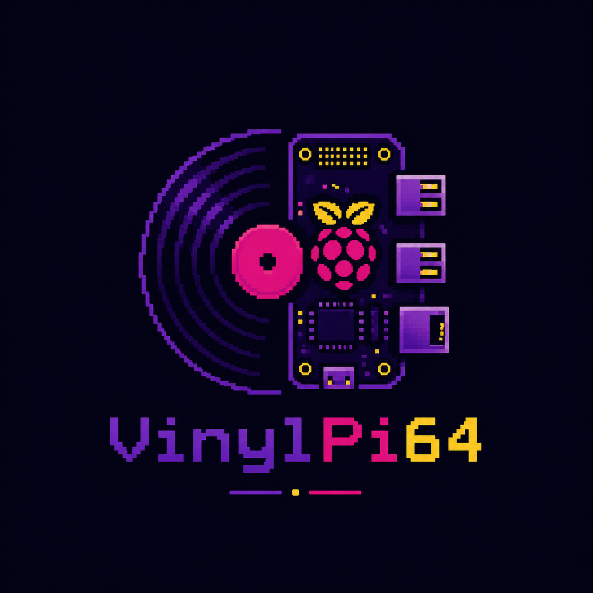
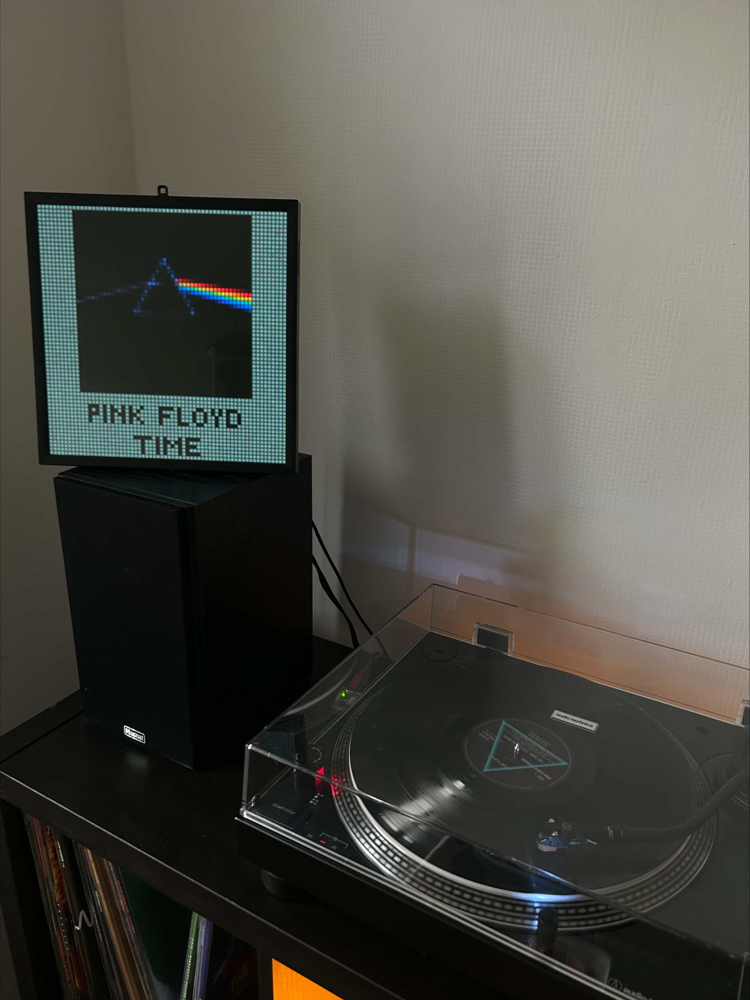
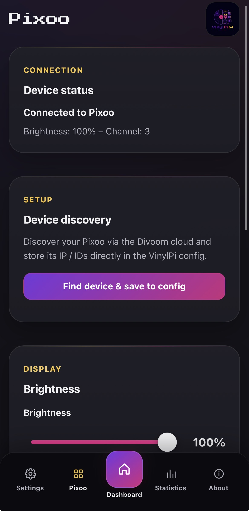
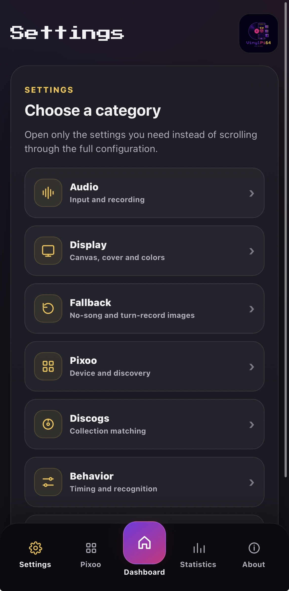
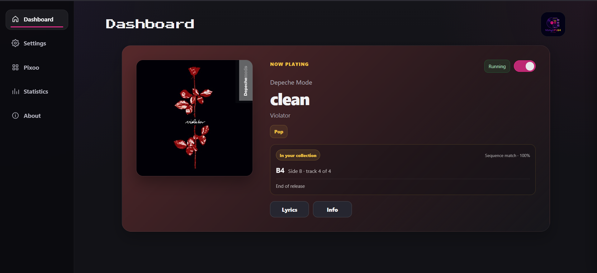
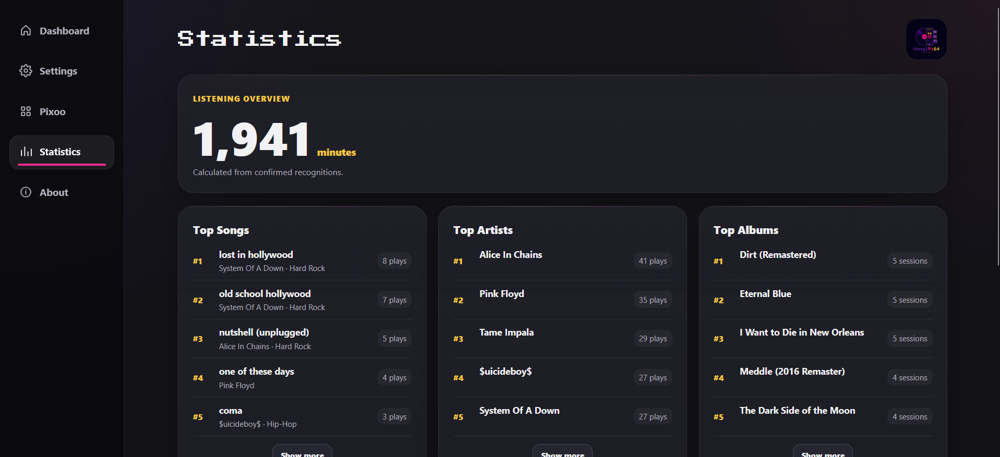

# VinylPi64

<p align="center">
  
  
  
  <a href="https://github.com/simontrost/VinylPi64/stargazers"></a>
</p>

VinylPi64 identifies music from a USB turntable using a native Rust fingerprinting client or from **Spotify**, builds a custom **64×64 pixel frame**, and displays it on a **Divoom Pixoo-64**. A local web app provides controls, settings, lyrics, device management, and listening statistics.

<p align="left">
  
</p>

## Features

- Vinyl recognition from USB audio using native Rust audio fingerprinting and Spotify playback recognition
- Album artwork, artist, title, album, genre, and track metadata
- Low-power audio standby with configurable wake-on-audio and audio-level auto-standby
- Optional failure-based auto-standby for Vinyl and Spotify
- Pickup usage tracking based on configurable input-level thresholds
- Custom Pixoo renderer with:
  - dynamic or manual background and text colors
  - configurable cover size, typography, spacing, and marquee text
  - fallback images
- Local web app with:
  - live dashboard updates and Vinyl / Spotify / Off modes
  - lyrics and track information
  - Pixoo brightness, channels, discovery, reboot, and community GIFs
  - statistics for listening time, pickup usage, songs, artists, albums, genres, and covers
- SQLite storage for songs, statistics, caches, and runtime state
- Configurable adaptive sample duration after failed recognitions
- Optional Home Assistant color-sync integration

## Hardware

This project was built and tested with:

- Raspberry Pi Zero 2 W
- Audio-Technica AT-LP120XUSB
- Divoom Pixoo-64

Other hardware can work as well, but may require adjustments. A turntable without USB output needs a compatible USB audio interface, and another display type requires a different display integration.

## Screenshots

### Generated Pixoo frame

<p align="left">
  
</p>

### Hardware setup

<p align="left">
  
</p>

### Web app
| Pixoo | Settings |
|---|---|
|  |  |

| Dashboard | Statistics |
|---|---|
|  |  |

## Experimental Rust branch

This branch replaces the Python backend with a Rust/Axum application. The HTML/CSS/JavaScript frontend remains. Its Windows build and automated tests have passed; operation with ALSA audio and Divoom hardware on Raspberry Pi still requires live validation.

### Build requirements (Linux)

- Rust stable (1.88+)
- `pkg-config` and `libasound2-dev`
- Optional: `alsa-utils` for `arecord -l`

```bash
sudo apt update
sudo apt install -y pkg-config libasound2-dev alsa-utils
cargo test --locked --workspace
cargo build --release --locked
```

A Pi Zero 2 W only has 512 MB RAM; compiling directly on the device may exceed its memory and disk capacity. Prefer the native ARM64 build produced by GitHub Actions or build on a stronger ARM64 Linux host. The repository does not currently provide a local cross-compilation script.

### Developer updates via GitHub Actions (no local Docker)

On the `refactor/rust` branch, each push triggers Rust tests and an **ARM64 native build** on GitHub Actions (`ubuntu-22.04-arm`). Only if all tests and the ARM64 build succeed does CI publish the binary to the rolling, **experimental** [`rust-dev` release](https://github.com/simontrost/VinylPi64/releases/tag/rust-dev). The release archive includes the full commit SHA and a SHA-256 checksum. This is **not** an official v1.0 release.

On the Pi, after you have checked out `refactor/rust` and installed the experimental ARM64 binary at least once:

```bash
# One-time: fetch the deployment scripts after merging them into the branch
cd ~/VinylPi64-rust
git pull --ff-only

# For each later update (wait until GitHub Actions is green):
bash scripts/update.sh
```

The update script fetches the latest `refactor/rust` commit, downloads the matching verified GitHub release asset, checks its commit SHA, fast-forwards Git, backs up the current executable and experimental data, and replaces the binary. If the separate `vinylpi64-rust.service` is running, it is stopped and restarted with an HTTP health check. A failed restart restores the previous binary and source checkout; any pre-update data backup is preserved for manual recovery. **Data migrations themselves are not automatically rolled back.** Old backups accumulate in `data/rust-update-backups`; remove obsolete ones manually after checking the new version.

A manually started server must be stopped with Ctrl+C before running the updater. If no service has been installed, `update.sh` updates the binary but does not start it automatically. To configure automatic startup **once**, after confirming the Python recognizer is not controlling the hardware:

```bash
cd ~/VinylPi64-rust
bash scripts/install-rust-service.sh
sudo systemctl status vinylpi64-rust.service
```

The optional service deliberately uses port **8081** and the separate `.rust-smoke-data` directory. It does not disable or remove the old Python service. Both applications must not actively control the same USB input and Pixoo simultaneously. The installer refuses to replace an existing systemd service file. This setup currently targets **64-bit Raspberry Pi OS (`aarch64`) only**.

The Pi needs `git`, `curl`, `tar` and `sha256sum`. Releases are fetched from this **public** GitHub repository; no personal GitHub token is stored on the Pi. If CI has not yet published the binary for the newest commit, the updater stops without replacing the installed binary. To check the build, open [GitHub Actions](https://github.com/simontrost/VinylPi64/actions).

### Safe first run (separate from the existing Python installation)

Clone this branch into a separate directory. Never point the experimental Rust process at the old Python data directory:

```bash
git clone --branch refactor/rust https://github.com/simontrost/VinylPi64.git ~/VinylPi64-rust
cd ~/VinylPi64-rust
mkdir -p .rust-smoke-data
./target/release/vinylpi64 --root . --data-dir .rust-smoke-data --port 8081 check
./target/release/vinylpi64 --root . --data-dir .rust-smoke-data --bind 0.0.0.0 --port 8081
```

The application uses the supplied directory for isolated runtime state; it does not need a profile login. The server root is required for templates, fonts, and image assets. Browse to `http://<pi-ip>:8081/` on the home network. Leave music playback stopped in the Rust instance while the original Python service controls the same Pixoo and USB input.

### Existing data migration

The default Rust data directory is `data/global`. Migrating legacy Python data should be performed explicitly and only after backup, using `migration-sources` and `migrate --source ...`; do not merge or overwrite multiple existing profiles without reviewing their contents. For a fresh smoke test use a dedicated empty `--data-dir` instead.

### Deployment

For a first hardware trial run the binary manually, not via systemd. Once the Raspberry Pi hardware functions are tested, a dedicated systemd unit may be created using `WorkingDirectory=<clone>` and `ExecStart=<clone>/target/release/vinylpi64 --root <clone> --data-dir <persistent-data-dir> --port 8080`. Disable or stop the old Python service before enabling production auto-start for the Rust version.

## Configuration

Most options can be changed from the **Settings** page. This includes:

- audio device, sample rate, channels, and recording duration
- adaptive recording durations after failed recognitions
- wake-on-audio, pickup thresholds, and Vinyl/Spotify standby behavior
- Spotify polling interval
- Pixoo layout, colors, text, cover size, and scrolling
- fallback images and Pixoo discovery
- Home Assistant integration and debug settings

The configuration is stored in:

```text
data/global/config.json
```

Runtime data is stored in:

```text
data/global/vinylpi.db
```

This database contains song history, play counts, listening statistics, caches, and the current dashboard state.

## Start on boot (after hardware validation)

Do not enable the Rust service until USB audio, Pixoo recovery and data migration have been tested and the old Python service is disabled. For an initial test run the Rust binary manually on port 8081. Once stable, create a dedicated systemd service pointing to the actual checkout and data directory; never reuse the old Python `ExecStart`.

## Optional: API token

Home Assistant control endpoints (`/api/ha/*`) require an API token:

```bash
VINYLPI_API_TOKEN=replace_with_a_long_random_value
```

Store it in `vinylpi.env` and keep that file private. **The other dashboard and device-control endpoints are not authenticated by this token.** Run the server only on trusted networks; do not expose port 8080/8081 directly to the public internet. Host and cross-origin checks are not a substitute for authentication.

## Optional: Home Assistant

VinylPi64 can send the dominant album-cover color to a Home Assistant webhook whenever a new song is recognized.

Enable the integration in the Settings page and provide:

- Home Assistant base URL
- webhook ID

Example Home Assistant automation:

```yaml
alias: VinylPi Color Sync
triggers:
  - trigger: webhook
    webhook_id: vinylpi_cover_color
    allowed_methods:
      - POST
      - PUT
    local_only: true
conditions:
  - condition: state
    entity_id: input_boolean.vinylpi_color_sync
    state: "on"
actions:
  - action: light.turn_on
    target:
      entity_id:
        - light.lamp1
        - light.lamp2
    data:
      rgb_color:
        - "{{ trigger.json.r | int }}"
        - "{{ trigger.json.g | int }}"
        - "{{ trigger.json.b | int }}"
mode: restart
```

Additional local API endpoints can be used for Pixoo power, music mode, and remote GIF playback.

## Recognition notes

Vinyl recognition uses recorded audio samples. Adaptive sampling can automatically use longer recordings after failed attempts and return to the base duration after a successful recognition.

With **Wake on Audio** enabled, the Off state keeps only a lightweight RMS level monitor active. Vinyl recognition starts when the configured wake threshold is reached and can return to standby after sustained low input. Pickup usage is measured from the same audio data, so it does not require a second audio stream.

Recognition quality depends on the audio level, selected passage, background noise, and Shazam's result. Quiet intros, live versions, heavy surface noise, or very short samples can reduce accuracy.

## Troubleshooting

### Audio device not found

```bash
arecord -l
```

Verify that the configured device-name filter matches the listed USB device.

### Web app starts, but recognition does not

Check the service logs or run the recognizer manually:

```bash
./target/release/vinylpi64 --help
```

### Pixoo does not respond

- confirm that the Pixoo and VinylPi are on the same network
- use device discovery in the Pixoo page
- verify the saved IP address
- reboot the Pixoo from the web app

### Service fails after an update

```bash
sudo journalctl -u vinylpi64-rust.service -n 100 --no-pager
sudo systemctl status vinylpi64-rust.service
# If installed through scripts/install-rust-service.sh, re-run the updater
# after fixing the GitHub Actions build or configuration:
bash scripts/update.sh
```

The updater retains the previous executable and a pre-update data archive in `data/rust-update-backups`. If a database schema changed, restore a backup only after inspecting its contents and stopping the Rust service.

## License

VinylPi64 is licensed under the Creative Commons Attribution–NonCommercial 4.0 International license.

See [LICENSE](LICENSE) for the full license text.
